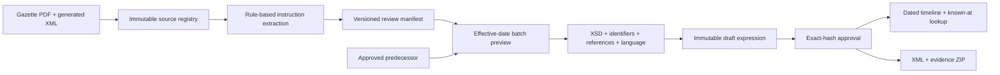

# Consolidation architecture

## Boundaries

- `akn_parser` still converts PDFs. `akn_consolidator` consumes its outputs; no conversion or source replacement is performed during stitching.
- `extraction.py` recovers a narrow set of English gazette instructions from PDF text. Amendment XML supplies section headings and tables. Unsupported patterns remain blocked. The principal Act number, jurisdiction, and year must match the imported work before a manifest can be ready.
- `engine.py` performs deterministic `lxml` edits on a copy. It never reads or writes the store. Each operation runs on a trial tree, and the first conflict stops dependent operations. A conflicted preview can contain the successful prefix for diagnosis; it cannot be applied or approved.
- `service.py` owns review state, legal/editorial dates, ordering, validation gates, source coverage, and approval. Both `cli.py` and `webui/consolidation.py` call it.
- `storage.py` coordinates processes using SQLite `BEGIN IMMEDIATE` and optimistic work revisions. Content-addressed artifacts are immutable through the service and verified on every read.

## Storage

The gitignored local directory contains `history.sqlite3` and `artifacts/<sha256>`. Sources, expression XML, and expression provenance bodies have independent artifact hashes. Files are created before SQLite references them; a failed transaction may leave an unreferenced artifact, but no partially registered expression. Back up the database **and** artifact directory together while writes are stopped. SQLite is the CMS system of record; Git versions code and regression fixtures, not individual lawyer edits.

| Record | Identity and versioning |
| --- | --- |
| Work | Stable FRBR Work URI, one optimistic revision counter |
| Source | Work, source kind, XML hash, PDF hash, registration timestamp |
| Manifest | Stable ID, append-only numbered body revisions, actor and reason |
| Expression | Parent, effective date, XML hash, body hash, creation/approval/invalidation timestamps |
| Event | Append-only action, actor, reason, timestamp, and affected IDs |

The source XML/PDF bytes are retained exactly. Expression serialization may differ from source serialization; preservation tests compare canonical untouched XML subtrees. Existing inline XML is preserved unless an explicit operation targets it.

## Time and replay

Legal effective dates and editorial timestamps are different dimensions. The base is initially an as-published snapshot. Extracted retrospective commencement is a candidate; “at once” does not silently become publication date. Manifest review must confirm a date and evidence. Individual operations can override a manifest date for partial commencement.

A preview selects exactly the next pending effective-date batch. Earlier pending operations must be applied first; same-date instruments require distinct explicit sequence numbers, and their operations execute in manifest order. An approved, non-stale predecessor is required. Applied operation keys include manifest ID, revision, and operation ID. A fresh preview cannot apply the same result twice against the same parent.

Reviewing a manifest invalidates expressions based on its old revision and their descendants. A newly reviewed earlier instrument also invalidates later consolidated expressions that omitted it. Rebuild from the last unaffected approved predecessor. Older XML remains inspectable, and historical `known_at` lookup can still return the version approved before the correction became known.

Preview hashes bind XML, ordered instructions, predecessor, and work revision. Applying reruns all transformations. Approval verifies the exact XML hash, predecessor, manifest revisions, current coverage replay, and validation. A newly registered instrument with unknown commencement blocks consolidation approval until resolved. There is no mutable “approved XML” file that a later edit can silently change.

## Identities and references

A provision's stable internal identity is stored separately from its printed number and `eId`. Renumbering changes the hierarchical `eId` and descendants while preserving identities. Replacements retain the root provision identity, tombstone removed descendants, and assign new identities to replacement children. Omissions retain tombstones; inserted nodes receive deterministic identities derived from the operation key.

Incoming `<ref>` links require explicit old/new href and displayed-text decisions for renumbering or deletion. The Third amendment needs a reference deleted by a later instruction in the same batch. The manifest records `resolved_by`, and the engine verifies that it names the exact later inline omission with matching ID, href, and text. Final whole-document validation catches any surviving dangling reference. Cross-inline omissions cannot silently flatten links.

FRBR expression dates and URIs are updated for the Act and schedules; the Work URI remains stable. Live same-work expression links follow the new date. Lifecycle amendment events and `analysis/passiveModifications` link the resulting expression to each source instruction and the predecessor target. The JSON manifest additionally supplies full quotes, pages, changes, stable identities, tombstones, and decisions. Separate legal effects remain classified in that manifest.

## Export

Only an approved, non-stale expression can be exported as an approved bundle. The deterministic ZIP includes `consolidated.xml`, `manifest.json`, source PDFs/XML, and XML for the expression history available at export time. The manifest includes all instruction revisions and audit events. Its completeness claim is limited to registered sources; the lookup API separately reports pending or unknown-date instruments. The raw XML inspection route also serves drafts and historical versions with an inspection label.
